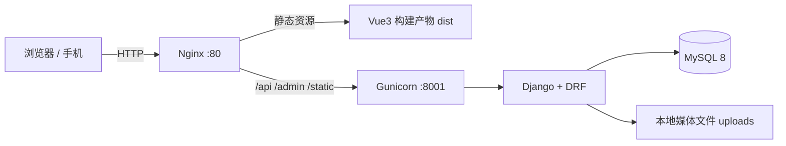

# 喵圈 MiaoQuan · 二次元全栈论坛

> 一个面向二次元爱好者的可爱风社区：发帖、评论、点赞、关注、加好友、私聊、消息通知与主题换肤，前后端分离，已真实部署于阿里云 ECS。

---

## 在线体验

**<http://121.43.108.53>**

> 网站支持自助注册，注册后即可体验发帖、评论、私聊、换肤等全部社区功能。

---

## 核心功能

### 社区内容
- **分区与帖子**：番剧讨论、手办周边、Cosplay、画师交流等分区；帖子支持 Markdown 正文、封面与多图上传。
- **评论互动**：两级评论（评论 / 回复），支持点赞与软删除。
- **点赞系统**：帖子与评论统一点赞表，唯一索引保证「一人一次」，支持「我点赞过的帖子」。
- **内容安全**：Markdown 渲染前经 DOMPurify 消毒，防止存储型 XSS。

### 社交关系
- **关注 / 粉丝**：关注、取关、粉丝列表与关注列表。
- **好友体系**：好友申请、同意 / 拒绝、双向好友关系；非好友不可私聊。
- **隐私开关**：用户可隐藏自己的发帖与点赞，他人访问返回 403 并展示友好提示。

### 私聊与消息
- **一对一私聊**：会话列表按最新消息排序，聊天页每 5 秒增量拉取新消息（`after` 游标），打开会话自动已读。
- **消息通知**：点赞、评论、关注、好友申请、好友通过等事件统一通知中心；好友申请可直接在铃铛内同意 / 拒绝。
- **实时未读提醒**：全局每 15 秒轮询「未读通知 + 未读私聊」汇总接口，铃铛红点自动更新；顶栏提供手动刷新按钮，适配移动端。
- **通知清理**：一键全部已读、清除全部已读通知。

### 账户与体验
- **JWT 认证**：Access 30 分钟 / Refresh 7 天，开启 Refresh Token 轮换与黑名单；支持「记住我」延长登录。
- **主题换肤**：内置樱花粉、天空蓝、深夜黑、抹茶绿 4 套皮肤，基于 CSS 变量 + `data-theme` 切换，用户偏好持久化到服务端，换设备登录依然保留。
- **响应式布局**：PC 与手机双端适配，移动端顶栏图标收缩、搜索折叠为放大镜、下拉菜单防溢出。
- **个人主页**：头像、昵称、等级、发帖 / 点赞 / 粉丝统计，他人视角提供关注、加好友、发私聊入口。

---

## 技术栈

| 层次 | 技术选型 |
| --- | --- |
| 前端 | Vue 3.5（Composition API + `<script setup>`）、TypeScript、Vite 5、TailwindCSS 3.4、Pinia、Vue Router、Axios |
| 后端 | Python 3.10+、Django 5.2 LTS、Django REST Framework 3.15、SimpleJWT、drf-spectacular、Pillow |
| 数据库 | MySQL 8.0（utf8mb4），生产环境索引与复合索引按查询路径设计 |
| 部署 | 阿里云 ECS（Ubuntu）、Nginx 反向代理、Gunicorn、systemd 开机自启、Shell 一键部署脚本 |
| 工程化 | Git、ESLint 风格的 TypeScript 严格检查（vue-tsc）、Markdown + DOMPurify、Argon2 密码哈希 |

---

## 系统架构



前端通过 Axios 统一封装请求、错误提示与 Token 刷新；后端按业务拆分为 `users / forum / social / chat / notifications / themes / common` 七个应用，接口统一挂载在 `/api/v1/` 下。

---

## 本地运行

### 环境要求

- Python ≥ 3.10
- Node.js ≥ 20
- MySQL ≥ 8.0（本地也可先用 SQLite 快速体验，见 `.env.example`）

### 后端

```bash
cd backend

# 1. 创建虚拟环境并安装依赖
python -m venv .venv
# Windows
.venv\Scripts\activate
# macOS / Linux
source .venv/bin/activate
pip install -r requirements.txt

# 2. 准备环境变量（不要提交 .env）
copy .env.example .env      # Windows
cp .env.example .env        # macOS / Linux
# 编辑 .env，填写数据库账号、密码等

# 3. 建表并写入基础数据
python manage.py migrate
python manage.py seed_boards
python manage.py seed_themes

# 4. 启动
python manage.py runserver
```

后端默认地址：<http://127.0.0.1:8000>，接口文档：<http://127.0.0.1:8000/api/docs/>

### 前端

```bash
cd frontend
npm install
npm run dev
```

前端默认地址：<http://localhost:5173>，开发环境已配置代理转发 `/api` 到后端。

### 生产构建

```bash
cd frontend
npm run build   # 先执行 vue-tsc 类型检查，再输出 dist/
```

---

## 目录结构

```text
anime-forum/
├── backend/                    # Django 后端
│   ├── apps/
│   │   ├── users/              # 用户、资料、隐私设置
│   │   ├── forum/              # 分区、帖子、评论、点赞
│   │   ├── social/             # 关注、好友申请、好友关系
│   │   ├── chat/               # 私聊消息与会话列表
│   │   ├── notifications/      # 通知中心与未读汇总
│   │   ├── themes/             # 主题皮肤与用户偏好
│   │   └── common/             # 公共模型与工具
│   ├── config/                 # 分环境配置（base / dev / prod）
│   ├── scripts/                # 数据库 DDL、本地开发脚本
│   ├── requirements.txt
│   └── manage.py
├── frontend/                   # Vue3 前端
│   ├── src/
│   │   ├── api/                # 接口封装与类型定义
│   │   ├── components/         # 通用组件（帖子卡片、通知铃铛等）
│   │   ├── layouts/            # 全局布局与顶栏
│   │   ├── stores/             # Pinia 状态（用户、未读数等）
│   │   ├── views/              # 页面（首页、帖子、私聊、个人中心…）
│   │   └── styles/             # Tailwind 与主题 CSS 变量
│   └── package.json
├── docs/                       # 架构与开发计划文档
├── deploy.sh                   # 阿里云一键部署脚本
└── README.md
```

---

## 部署说明

项目已通过根目录的 `deploy.sh` 完整部署到阿里云 ECS，脚本覆盖：

1. 安装 Python / MySQL / Nginx / Node.js 等系统依赖；
2. 创建数据库并生成后端 `.env`（密钥随机生成，数据库密码由环境变量传入）；
3. 前端依赖安装与生产构建；
4. 后端虚拟环境、`migrate`、`collectstatic`；
5. 生成 Nginx 站点与 systemd 服务配置，启动并设置开机自启。

```bash
# 数据库密码通过环境变量传入，不写进仓库
DB_PASSWORD='你的强密码' sudo -E bash deploy.sh
```

---

## 工程与安全实践

- `.env`、数据库文件、虚拟环境、`node_modules`、构建产物均已加入 `.gitignore`，密钥不进入版本库；
- 生产环境 `DEBUG=False`、缺少 `DJANGO_SECRET_KEY` 时启动即报错；
- 密码使用 Argon2 哈希，接口统一 JWT 鉴权；
- 查询层按用户过滤（`get_queryset`），隐私数据不会因对象级判断缺失而泄露；
- 通知去重、未读计数、会话列表均使用聚合查询，避免 N+1；
- 前端统一 Axios 拦截器处理错误、401 刷新与登录过期跳转。

---

## 接口一览（节选）

| 方法 | 路径 | 说明 |
| --- | --- | --- |
| POST | `/api/v1/auth/login/` | 登录，返回 Access / Refresh Token |
| POST | `/api/v1/auth/refresh/` | 刷新 Access Token（轮换 Refresh） |
| GET | `/api/v1/forum/posts/` | 帖子列表（分区、搜索、排序） |
| POST | `/api/v1/forum/posts/` | 发布帖子 |
| GET | `/api/v1/forum/posts/{id}/comments/` | 评论列表 |
| POST | `/api/v1/social/users/{id}/follow/` | 关注 / 取关 |
| POST | `/api/v1/social/friend-requests/` | 发送好友申请 |
| GET | `/api/v1/chat/conversations/` | 私聊会话列表 |
| GET | `/api/v1/chat/messages/?user={id}&after={id}` | 增量拉取聊天记录 |
| GET | `/api/v1/notifications/unread-summary/` | 未读汇总（通知 + 私聊） |
| GET | `/api/v1/notifications/` | 通知列表 |

完整接口与参数说明可在本地启动后访问 `/api/docs/` 查看。

---

> 本项目为个人全栈作品，用于学习与技术展示。
